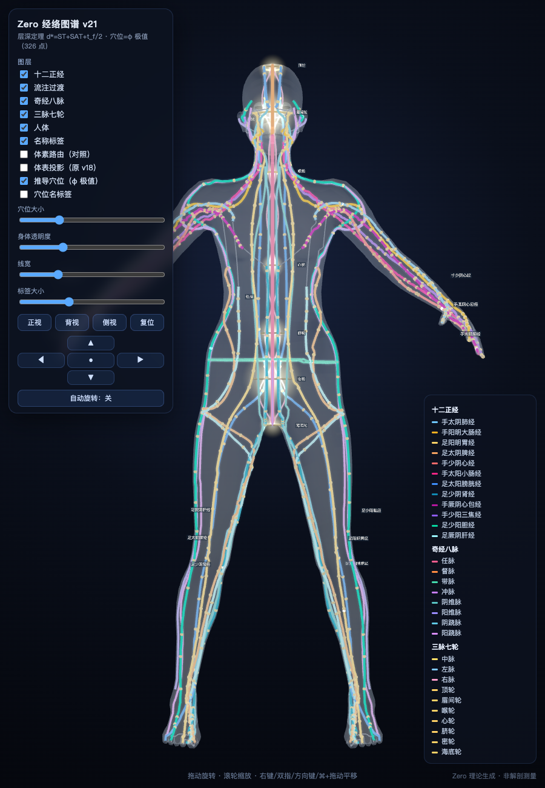

# Zero Meridian & Acupoint Atlas

A 3D meridian and acupoint atlas **computed from the Zero framework** on a neutral human model — the channels are derived from a variational principle, not traced from traditional charts.

### ▶ [Open the interactive 3D atlas](https://sdoygb.github.io/Zero-Meridian-Acupoints/)



The page is a single self-contained HTML file (`index.html`, ~1.9 MB, no network needed). Drag to rotate, scroll to zoom, right-drag to pan; the left panel toggles layers.

## What it shows

| Layer | Content |
|:--|:--|
| 12 primary meridians | port-to-port surface geodesics, then lowered to the computed channel depth |
| 流注 transitions | 8 limb/head transitions + 3 deep transitions, at the same depth |
| 8 extraordinary vessels | Ren, Du, Dai, Chong, Wei (yin/yang), Qiao (yin/yang) |
| 3 channels, 7 chakras | central / left / right channel, 7 wheel rings along the axis |
| **326 acupoints** | local extrema of the field φ along each channel (Zc014), labelled with approximate traditional names |
| 3 channels / 7 chakras | central channel = max-clearance axis; left/right = equal-winding helices on the core shell; chakra = φ extremum along the axis (Zc015): 5 of 7 traditional wheels within 5 cm |
| Depth | theorem value d\* = ST + SAT + t_f/2 (Zc013), 4.5–8.9 mm by body region |

## Theory in brief

The Zero framework describes a meridian as the set of **ports–channels–extrema**:

- a channel is `argmin ∫ ds / w` over a causal allowed set C, where w = propagation rate (tissue-dependent);
- **interface theorem**: a channel runs at a tissue interface when `w_i > λ·max(w1, w2)`, `λ = L_i / L_b`;
- **depth**: `d* = ST + SAT + t_f/2` — subcutaneous thickness + superficial adipose + half the fascia thickness (Zc013);
- **acupoints**: a point is a port; a *special* point is a local extremum of φ along the channel; the 1D index theorem gives `#max − #min ∈ {−1, 0, 1}` (Zc011).

The formal derivations are in the five articles at the repository root (`Zc011`–`Zc015`): ports and channels, the 361-point comparison, the interface depth theorem, acupoint positions as field extrema, and the three channels / seven chakras (max-clearance axis, equal-winding helices, chakra = field extremum along the axis).

## Repository layout

```
index.html                  # the 3D atlas (GitHub Pages entry)
data/model/                 # neutral body mesh (MakeHuman base, CC0)
data/atlas2/                # channel geometry + build inputs (JSON)
data/zc013/                 # layer measurements (ST/SAT/t_f), audit outputs
data/zc014/                 # field φ, derived acupoints, naming, comparison
data/zc015/                 # WHO landmark anchors, TARA coordinates, depth anchors
src/atlas2/                 # mesh loading, surface routing, stage 1–5, HTML builder
src/zc013/                  # layer model, theorem application, audit
src/zc014/                  # φ fields, extremum extraction, naming
src/zc015/                  # anchor construction, TARA extraction, registration
Zc011–Zc015*.md             # theory articles
```

## Rebuild

```bash
pip install numpy scipy matplotlib
python3 src/atlas2/build_html.py v21     # writes data/atlas2/zero_atlas_v21.html
python3 src/zc014/phi_fields.py          # φ fields (port harmonic + bone distance)
python3 src/zc014/derive_points.py       # 326 acupoints
```

The HTML builder is self-contained (three.js r128 inlined); no bundler required.

## Validation (measured, not fitted)

Comparison against independent references (details in `Zc014` §5 and `data/zc014/compare_*.json`):

| Comparison | Median distance | ≤ 3 cm |
|:--|--:|--:|
| Channels vs 10 WHO-landmark anchors (no charts involved) | **2.0 cm** | — |
| Channels vs traditional 2D charts, per-view calibrated | 2.5 cm | 58 % |
| Acupoints vs WHO-landmark anchors | 2.7 cm | — |
| Acupoints vs traditional 2D charts, calibrated | 3.4 cm | 42 % |


Channel depth vs **measured needling depths** (literature: 5.5–21.2 mm ideal insertion, ultrasonic GB21/ST36 targets 22–26 mm): the channel layer (fascia, ~5 mm) and the stimulation target (muscle, 10–30 mm) are two different layers — see `data/zc015/depth_anchors.json`.

## Data provenance

- Body mesh: MakeHuman `hm08` base (CC0), body-only export.
- Traditional point catalogue and WHO location texts: `data/` (compare-only, never used to place the computed points).
- TARA repository public Unity build: acupoint coordinates extracted for anchor-registration experiments (`data/zc015/tara_points.json`); these are scaffold positions, not skin.
- Layer thicknesses: published ST/SAT/fascia measurements recorded in `data/zc013/layers.json` with URLs.

## Limitations

- φ is not measured; two proxies (port harmonic field, bone distance) give the same total order of points but different per-meridian distributions.
- Lateral channel position is a structural choice (corridor stations), not a theorem output; sensitivity to a 0.8 cm corridor shift is 0.34 cm.
- Comparison references are 2D chart projections; individual anatomical variation (≈1–2 cm) and the absence of a unified 3D standard bound further accuracy claims.
- Only the 12 primary meridians have computed acupoints so far.

## License

Code: MIT. Text (`Zc011`–`Zc014`): CC BY 4.0. Body mesh: CC0 (MakeHuman).
